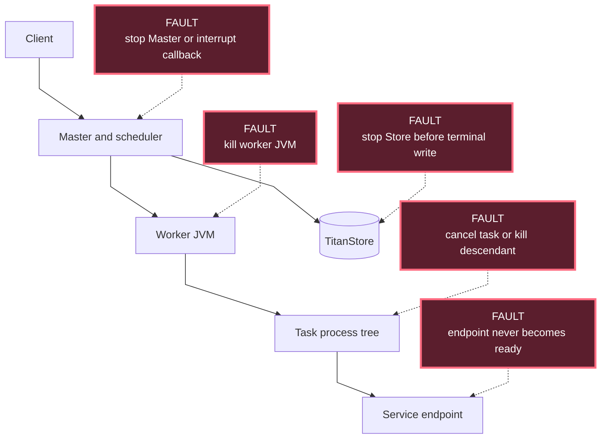
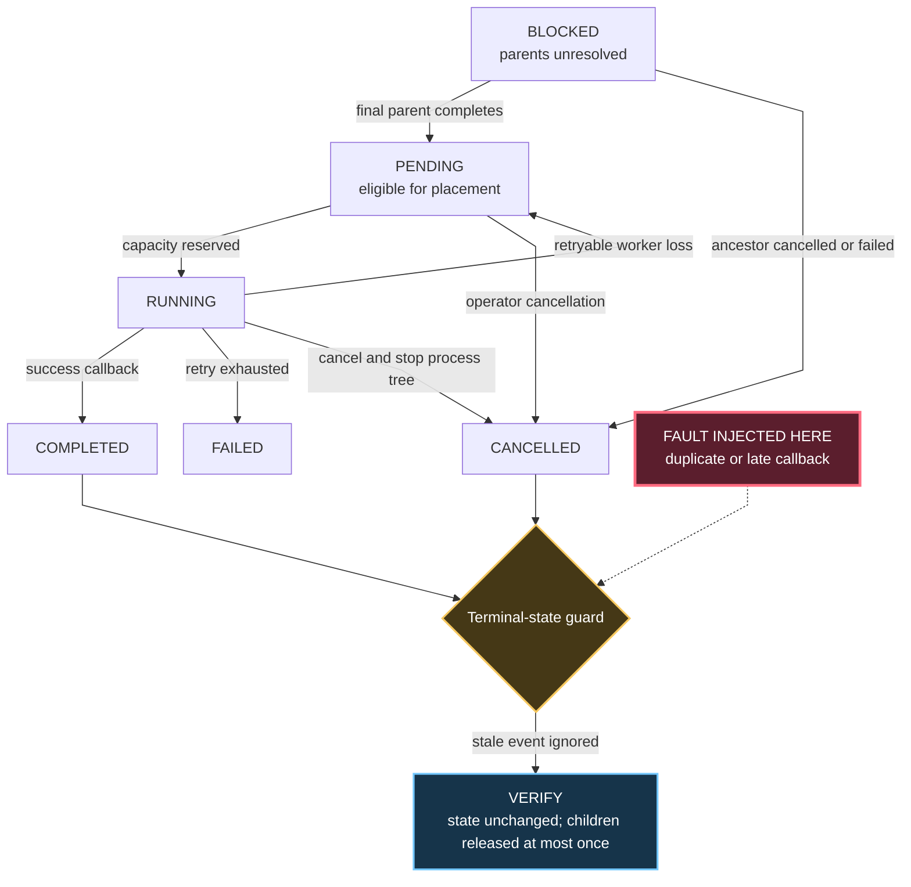
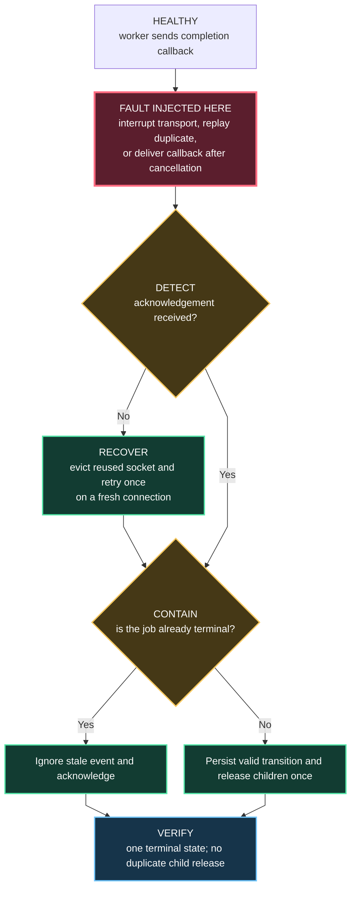
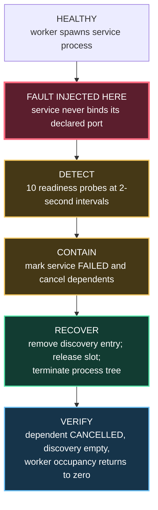
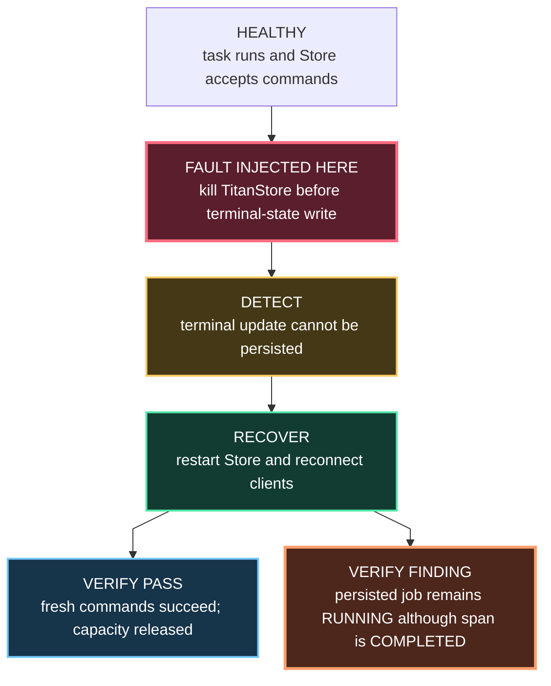

# Fault Tolerance & Recovery

Titan treats failure recovery as part of job execution. The Master records job state, workers report health and completion, and recovery logic decides whether work should remain terminal, be retried, or be quarantined.

This page explains the recovery model and the failure behavior measured by Titan's fault-injection campaigns. It does not describe Titan as a highly available control plane: the current Master is a singleton and requires restart after failure.

!!! abstract "Measured recovery summary"
    - **Single machine:** 14/14 scheduler-lifecycle and process-lifecycle cases reached their expected final state.
    - **Two VMs:** 5/7 live distributed cases satisfied every invariant.
    - **Three VMs:** 6/8 live distributed cases satisfied every invariant; median convergence for timed passing cases was **8.64 s**.
    - **Findings reproduced in both distributed topologies:** missed terminal-state reconciliation after a Store outage, and stale service discovery after a rapid worker restart.

## 1. Recovery model

Titan separates recovery into four concerns:

| Concern | Mechanism | Required outcome |
| --- | --- | --- |
| Detect | Worker heartbeats, connection failures, readiness probes | Identify an unavailable worker, transport, Store, or service |
| Contain | Terminal-state guards, cancellation cascades, process-tree termination | Prevent duplicate release, revived jobs, leaked capacity, and orphan processes |
| Recover | Redispatch, callback retry, worker re-registration, Store reconnect | Resume eligible work without violating DAG dependencies |
| Reconcile | Persisted status and service-discovery cleanup | Make durable and visible state agree with the execution outcome |

Each diagram uses the same visual language: **red marks the injected fault**, amber marks detection or containment, green marks recovery, and blue marks the invariant checked by the verifier.

| Injection point | Exact injected action | Primary verification |
| --- | --- | --- |
| Master / callback ingress | Stop the Master, interrupt a callback, or replay a duplicate or late callback | One terminal transition and at most one child release |
| TitanStore | Stop the Store before the task's terminal-state write | Reconnection and agreement between persisted status and the completed span |
| Worker JVM | Kill the worker while a root task is `RUNNING` | Redispatch, dependent completion, released capacity, and dependency order |
| Task process tree | Cancel after a child process exists | Parent and descendant processes removed on every worker |
| Service endpoint | Launch a process that never binds the declared port | Bounded failure, dependent cancellation, empty discovery, and released slot |

A fault case counts as a pass only when **all stated invariants** hold. A job eventually completing is insufficient if it also leaves stale discovery state, duplicates a dependent, or loses its durable terminal status.

## 2. Job lifecycle safety

The scheduler owns the job state machine. A completion, cancellation, or failure callback is accepted only when it is valid for the current state. Terminal jobs are not reopened by duplicate or late messages.

### Dependency release

When several parents finish concurrently, each completion updates the child's remaining dependencies. Removal from the waiting set is the gate that admits a child to the ready queue. Only the thread that removes the child can queue it, preventing duplicate release.

Child registration also checks parent state before and after joining the waiting set. This covers a parent completing immediately before or during registration.

### Retry semantics

Titan recovery is **at least once**. A worker or Master interruption can cause a task to launch again when the earlier attempt cannot be proven complete. Tasks with external side effects should therefore use an idempotency key or make their output commit atomic.

## 3. Worker loss and redispatch

Workers register with the Master and send periodic heartbeats. When a worker is declared unavailable, Titan removes it from scheduling, releases its recorded capacity, and makes recoverable in-flight work eligible for redispatch.

In the three VM campaign, killing a worker during a 60-second root stage produced:

- `RUNNING → PENDING → RUNNING → COMPLETED`
- the dependent job completed
- zero dependency-order violations
- 105.848 s from requeue to completion

The full case lasted 155.778 s because its wall time included injection, failure detection, redispatch, execution, and verification.

## 4. Callback and cancellation safety

Workers retry completion callbacks when the Master connection fails. A failed reused socket is evicted and the request is attempted once on a fresh connection before the worker is treated as unreachable.

The receiver must still be idempotent because network retry cannot prove whether the earlier message was processed.

Measured distributed results:

- Two injected duplicate callbacks were acknowledged; root and child remained `COMPLETED`.
- A late `COMPLETED` callback after cancellation was acknowledged; root and dependent remained `CANCELLED`.
- During a Master interruption, callback retries reached the restarted Master and the job completed. The three VM case recorded two callback failures, a 1.513 s Master restart, and completion 8.641 s after restart.
- That Master-interruption case launched the task twice, demonstrating why the contract is at least once.

Cancellation propagates to dependent jobs and instructs the worker to terminate the process tree. The three VM descendant-cleanup case inspected both workers and found zero matching parent or child processes afterward.

## 5. Service lifecycle recovery

Long-running services become discoverable only after their readiness condition succeeds. A failed readiness probe marks the service failed, cancels dependent work, removes discovery state, and releases worker capacity.

The distributed readiness-failure test used ten probes at two-second intervals. The service failed in 18.365 s, its dependent was cancelled, discovery was empty, and both workers returned to zero occupied slots.

Worker restart cleanup also removed a journaled service parent and child process. However, one endpoint remained in discovery after a rapid restart at the same worker address. Process cleanup passed; discovery reconciliation did not.

## 6. Store and Master interruption

### TitanStore

TitanStore persists state through its append-only file and clients can reconnect after the process restarts. This protects data that reached the Store before the outage.

The fault campaign exposed a narrower gap: when a terminal status write occurred while the Store was unavailable, fresh operations worked after restart but the missed write was not replayed. The execution span showed `COMPLETED` and capacity was released, while persisted job status remained `RUNNING` for the 120-second observation window.

This means Store restart and Store state reconciliation are different properties. Reconnection is measured as working; replay of a missed terminal transition remains an open item.

### Master

The Master can be restarted and reconstruct persisted state, and workers can retry callbacks across the interruption. While the Master is down, the control plane cannot admit or dispatch new work.

Titan currently provides **restart recovery**, not zero-downtime Master failover. It has no leader election or consensus protocol, and two independent Masters must not control the same worker and state realm.

## 7. Measured fault matrix

The table below summarizes the live three VM campaign. Observation time includes fault injection, detection, recovery, and verification.

| Injected failure | Observed behavior | Time | Result |
| --- | --- | ---: | --- |
| Worker terminated during a running root | Redispatched; root and dependent completed | 155.778 s | Pass |
| Duplicate completion callbacks | 2/2 acknowledged; no terminal-state change | 2.541 s | Pass |
| Late completion after cancellation | Root and dependent stayed cancelled | 0.823 s | Pass |
| TitanStore killed during execution | Reconnected, but missed terminal write stayed `RUNNING` | 127.071 s | Finding |
| Service never became ready | Service failed, dependent cancelled, discovery cleared | 19.354 s | Pass |
| Cancel after spawning descendant | No matching processes remained on either worker | 1.081 s | Pass |
| Worker restart with live service tree | Orphans removed; one stale endpoint remained | 15.000 s | Finding |
| Master killed across callback | Callback retried; final state completed | 14.468 s | Pass |

The same two findings were reproduced in the two VM campaign. The single-machine suite passed all 14 tested scheduler and process-lifecycle cases, but local success is not used as evidence for cross-host recovery.

## 8. What Titan currently guarantees

Within the tested configurations, Titan has evidence for:

- dependency-safe redispatch after worker loss;
- duplicate callback suppression;
- rejection of late callbacks after cancellation;
- cancellation cascades and descendant process cleanup;
- bounded service-readiness failure;
- worker re-registration and orphan cleanup;
- callback recovery across a restarted Master;
- Store reconnection after restart.

Titan does not currently claim:

- zero-downtime Master high availability;
- consensus or split-brain prevention between Masters;
- exactly-once task side effects;
- replay of every state transition missed during a Store outage;
- complete service-discovery reconciliation after every rapid worker restart;
- automatic cloud VM provisioning.

## 9. Operating guidance

1. Keep the Master, workers, and Store on a trusted LAN or VPC.
2. Make externally visible task effects idempotent; use the execution or attempt identifier as a deduplication key.
3. Write final artifacts atomically, then report completion.
4. Monitor persisted job status and execution spans together after a Store outage.
5. Remove or verify stale service endpoints after a worker restart until discovery reconciliation is implemented.
6. Restart the singleton Master promptly; scheduling pauses while it is unavailable.

For the full methodology, topology split, per-case evidence, and benchmark limitations, see the [Benchmark Overview](../benchmarks/index.md) and [interactive benchmark report](../benchmarks/titan-benchmark-report.html#reliability).
