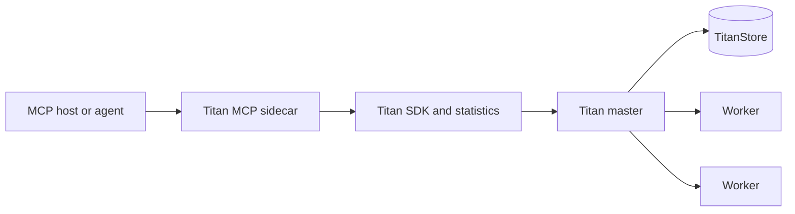
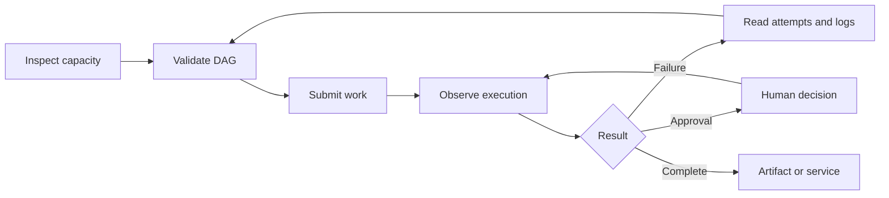
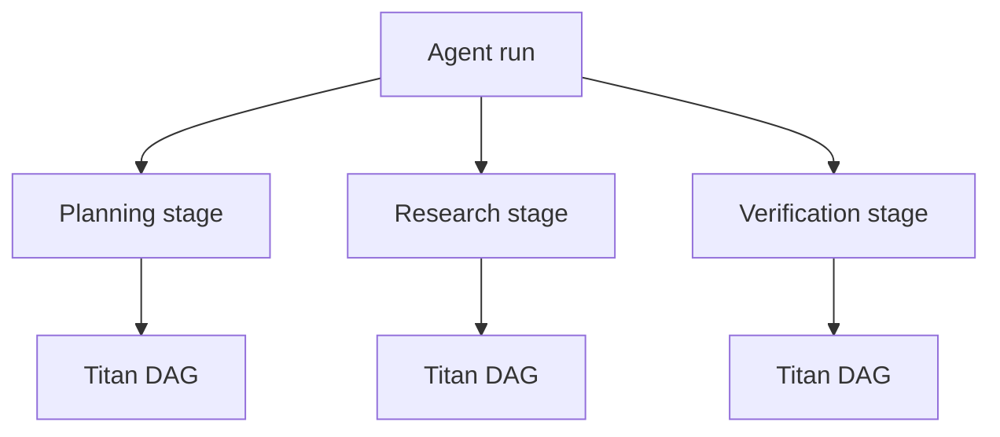

# MCP Control Plane

Titan's Model Context Protocol (MCP) sidecar lets MCP-compatible agents operate a Titan cluster through typed tools.

The agent decides what work to request. Titan remains responsible for dependencies, scheduling, worker selection, execution, retries, persistence and service lifecycle.

!!! info "Status"
    The sidecar provides 30 tools and is ready for controlled development use. It passed 20 automated tests, the official MCP Inspector check and a two-VM GCP functional campaign.

## How it works



The sidecar is an adapter over Titan's existing interfaces. It does not add another scheduler, change the RPC protocol or expose raw opcodes.

An agent can use it as one connected loop:



## What agents can do

| Group | Tools | Capability |
| --- | ---: | --- |
| Observe and plan | 18 | Inspect the cluster, workers, capabilities, queues, jobs, DAGs, agent runs, approvals, logs, failures, spans and metrics; validate DAGs and wait for jobs |
| Execute | 2 | Submit one job or a complete DAG, including an agent-stage identity |
| Control | 4 | Cancel work, resolve or stop a service, and decide a human approval gate |
| Data | 6 | Read or write namespaced workflow data and transfer guarded artifacts |

The complete tool names are available below for client configuration and auditing.

??? note "All 30 tools"
    **Observe and plan**

    `titan_cluster_status`, `titan_list_workers`, `titan_get_capabilities`, `titan_list_services`, `titan_inspect_queue`, `titan_list_jobs`, `titan_get_job`, `titan_get_job_logs`, `titan_get_timeline`, `titan_get_metrics`, `titan_get_span_history`, `titan_get_dag`, `titan_list_agent_runs`, `titan_get_agent_run`, `titan_list_pending_approvals`, `titan_validate_dag`, `titan_wait_for_jobs`, `titan_list_failures`

    **Execute**

    `titan_submit_job`, `titan_submit_dag`

    **Control**

    `titan_cancel_job`, `titan_resolve_service`, `titan_stop_service`, `titan_hitl_decide`

    **Data**

    `titan_kv_get`, `titan_kv_put`, `titan_kv_add`, `titan_kv_members`, `titan_upload_asset`, `titan_fetch_artifact`

## Safety model

The default profile is read-only. Set `TITAN_MCP_OPERATOR=true` only for a client allowed to submit or change work.

The sidecar also enforces:

- Canonical file paths inside `TITAN_MCP_ALLOWED_ROOTS`
- Bounded files, waits, listings, logs and telemetry responses
- Store access under `user:mcp:` by default
- Strict schemas that reject unknown fields and invalid types
- MCP safety annotations for mutating tools
- Protocol output on stdout and operational logs on stderr

It does not expose arbitrary shell execution, worker termination, statistics deletion, unrestricted Store keys or raw Titan opcodes.

## Start the sidecar

The sidecar requires Python 3.10 or newer and adds no third-party runtime dependency.

=== "Linux and macOS"

    ```bash
    TITAN_HOST=127.0.0.1 \
    TITAN_PORT=9090 \
    TITAN_MCP_ALLOWED_ROOTS=/absolute/workspace \
    python -m titan_mcp
    ```

=== "Windows PowerShell"

    ```powershell
    $env:TITAN_HOST = "127.0.0.1"
    $env:TITAN_PORT = "9090"
    $env:TITAN_MCP_ALLOWED_ROOTS = "D:\workflows"
    python -m titan_mcp
    ```

Use colon-separated roots on Unix and semicolon-separated roots on Windows.

## Connect an MCP host

Configure the host to launch Titan as a local stdio server:

```json
{
  "mcpServers": {
    "titan": {
      "type": "stdio",
      "command": "python",
      "args": ["-m", "titan_mcp"],
      "cwd": "/absolute/path/to/titan-orchestrator",
      "env": {
        "TITAN_HOST": "127.0.0.1",
        "TITAN_PORT": "9090",
        "TITAN_MCP_OPERATOR": "false",
        "TITAN_MCP_ALLOWED_ROOTS": "/absolute/workspace"
      }
    }
  }
}
```

Use absolute paths because desktop hosts may not inherit the shell's working directory or environment.

### Inspect it

```bash
npx -y @modelcontextprotocol/inspector --web --config inspector-config.json
```

The Inspector renders every tool's schema, arguments, annotations and result.

## Agent runs and DAGs

Titan keeps the model's decision stages connected to the DAGs that were executed:



`titan_list_agent_runs` shows the stage summary. `titan_get_agent_run` expands it into DAGs, dependencies, jobs, workers and attempts.

## Where it adds value

### Scientific and multi-agent workflows

Agents can choose new stages from intermediate results while Titan records and executes the resulting dependency graphs across workers.

### Governed automation

Work can pause before publication, deployment, expensive compute or another external action. The pending decision is visible through MCP and Titan's dashboard.

### Services and artifacts

A workflow can produce a file or deploy a long-running service. The client can fetch the artifact or resolve the ready endpoint through the same interface.

### Operational assistance

An agent can explain blocked work using queue state, dependencies, attempts, logs, worker capacity and timeline evidence.

### Benchmark control

A runner can validate, submit, wait and collect failures and telemetry without using Titan's private wire protocol.

### Future realm management

A separate privileged MCP server could create and scale complete Titan deployments from approved infrastructure profiles. It should remain separate so cloud credentials and destructive infrastructure authority are not placed inside each execution realm.

Realm provisioning is not part of the current 30 tools.

## Verification

| Check | Result |
| --- | --- |
| Automated protocol, authorization and tool tests | 20 passed |
| Large validation case | 2,000 nodes and 1,999 edges |
| Official MCP Inspector | All 30 tools discovered; read-only rejection passed |
| Distributed functional campaign | Master and TitanStore on one GCP VM; remote four-slot worker on a second VM |
| Live behaviors | Dependencies, cancellation, approval, retries, service lifecycle, data, artifact hash and timeline passed |
| Cleanup | Empty queue, no active job and no advertised service |

The GCP campaign verifies functionality. It is not a throughput benchmark.

## Current limits

- The supported transport is local stdio. Remote access still needs authentication, authorization and audit logging.
- DAG and agent metadata comes from the SDK journal visible to the sidecar.
- Artifact retrieval requires an exact name because Titan has no cluster-wide artifact index.
- Runtime DAG mutation is not exposed because the SDK has no stable public mutation contract yet.
- Realm provisioning is not implemented.
- Additional MCP hosts, a 1,000-task live submission, the full failure campaign and the Windows/Linux/macOS live matrix remain release gates.

The implementation is isolated under `titan_mcp/`. Existing SDK, YAML, CLI and dashboard clients continue to work independently.
