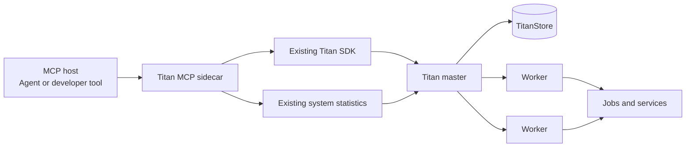
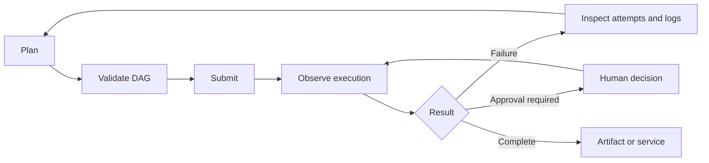
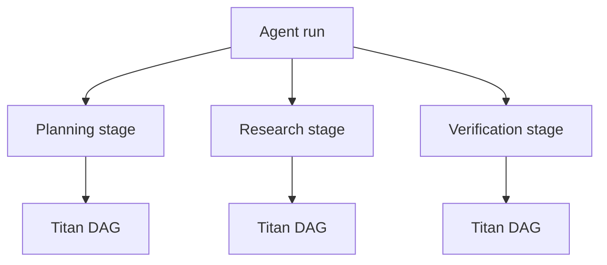

# MCP Control Plane

Titan provides a Model Context Protocol (MCP) sidecar that makes its distributed runtime available to MCP-compatible agents and developer tools.

The sidecar exposes Titan's existing Python SDK and system statistics as typed MCP tools. Titan remains responsible for scheduling, dependency release, worker selection, retries, persistence and service lifecycle. The MCP host supplies intent and invokes the operations.

!!! info "Current status"
    The MCP sidecar is intended for controlled development use. It provides 30 tools, passes the official MCP Inspector compatibility check and has completed a two-VM GCP functional campaign. Remote transport authentication, additional client compatibility and the full load and fault matrix remain release gates.

## Why MCP is useful for Titan

Titan already provides the execution primitives needed by agentic applications:

- Distributed jobs and dependency graphs
- Runtime-sized agent stages
- Capability-aware workers
- Long-running services
- Cancellation and retry handling
- Human approval gates
- Logs, spans and cluster telemetry
- Workflow data and artifact exchange

MCP provides one standard interface through which an agent can inspect, plan, execute and supervise these operations.



The sidecar does not add a scheduler, replace the Titan SDK or move execution decisions into the language model. It adapts the existing control surface to MCP.

## What it adds

The MCP interface gives an agent a complete control loop:

1. Inspect cluster capacity and advertised capabilities.
2. Validate a proposed DAG without submitting it.
3. Submit a job, DAG or agent stage.
4. Wait for selected jobs and inspect state transitions.
5. Diagnose blocked dependencies, attempts and failures.
6. Discover and decide human approval gates.
7. Resolve or stop a deployed service.
8. Exchange namespaced workflow data and verified artifacts.



## Tool surface

The server advertises 30 tools in four groups.

### Observe and plan

| Tool | Purpose |
| --- | --- |
| `titan_cluster_status` | Compact health, capacity, queue and service summary |
| `titan_list_workers` | Registered workers, capabilities, load and recent history |
| `titan_get_capabilities` | Aggregate workers, slots and free slots by capability |
| `titan_list_services` | Currently advertised service endpoints |
| `titan_inspect_queue` | Ready, blocked, delayed and running queue lanes |
| `titan_list_jobs` | Bounded and filtered job listing |
| `titan_get_job` | Current status, metadata and attempts for one job |
| `titan_get_job_logs` | Bounded log tail for one job |
| `titan_get_timeline` | Bounded execution spans from the live timeline |
| `titan_get_metrics` | Scheduler and fleet telemetry |
| `titan_get_span_history` | Persisted execution spans for a UTC date |
| `titan_get_dag` | DAG shape, state, blocked parents and attempts |
| `titan_list_agent_runs` | Agent runs reconstructed from stage metadata |
| `titan_get_agent_run` | One agent run with its ordered stage DAGs |
| `titan_list_pending_approvals` | Waiting human-review gates and their prompts |
| `titan_validate_dag` | Files, identifiers, parents, cycles and capabilities |
| `titan_wait_for_jobs` | Bounded wait for any or all selected jobs |
| `titan_list_failures` | Failed, dead and rejected attempts from timeline evidence |

### Execute

| Tool | Purpose |
| --- | --- |
| `titan_submit_job` | Submit one script or service through the existing SDK |
| `titan_submit_dag` | Submit a validated DAG, optionally as an agent stage |

### Control

| Tool | Purpose |
| --- | --- |
| `titan_cancel_job` | Cancel a queued or running job and its dependants |
| `titan_resolve_service` | Resolve a ready service to its host and port |
| `titan_stop_service` | Stop a service by its exact job identifier |
| `titan_hitl_decide` | Approve or reject one waiting review gate |

### Data and artifacts

| Tool | Purpose |
| --- | --- |
| `titan_kv_get` | Read a value from the MCP workflow namespace |
| `titan_kv_put` | Write a value to the MCP workflow namespace |
| `titan_kv_add` | Add a member to a namespaced workflow set |
| `titan_kv_members` | List members of a namespaced workflow set |
| `titan_upload_asset` | Upload a bounded file from an allowed root |
| `titan_fetch_artifact` | Fetch an artifact into an allowed destination |

## Safety boundary

The default profile is read-only. Mutation tools require:

```text
TITAN_MCP_OPERATOR=true
```

The sidecar also applies the following boundaries:

- Local paths are canonicalized and must remain inside `TITAN_MCP_ALLOWED_ROOTS`.
- Script and artifact sizes are bounded.
- Store access is restricted to `user:mcp:` by default.
- Titan's internal Store key delimiter is rejected in user values and keys.
- Waits, listings, logs and telemetry responses have explicit limits.
- Tool schemas reject unknown fields and invalid types.
- Mutating tools carry MCP safety annotations.
- Protocol logs are written to stderr so stdout remains a valid MCP stream.

The sidecar intentionally does not expose arbitrary shell execution, worker termination, statistics deletion, unrestricted Store keys or raw Titan opcodes.

## Start the sidecar

The sidecar requires Python 3.10 or newer and has no third-party runtime dependency.

=== "Linux and macOS"

    ```bash
    TITAN_HOST=127.0.0.1 \
    TITAN_PORT=9090 \
    TITAN_MCP_ALLOWED_ROOTS=/absolute/workspace \
    python -m titan_mcp
    ```

=== "Windows PowerShell"

    ```powershell
    $env:TITAN_HOST = "127.0.0.1"
    $env:TITAN_PORT = "9090"
    $env:TITAN_MCP_ALLOWED_ROOTS = "D:\workflows"
    python -m titan_mcp
    ```

Use colon-separated roots on Unix and semicolon-separated roots on Windows.

## Configure an MCP host

An MCP host should launch the sidecar as a stdio child process:

```json
{
  "mcpServers": {
    "titan": {
      "type": "stdio",
      "command": "python",
      "args": ["-m", "titan_mcp"],
      "cwd": "/absolute/path/to/titan-orchestrator",
      "env": {
        "TITAN_HOST": "127.0.0.1",
        "TITAN_PORT": "9090",
        "TITAN_MCP_OPERATOR": "false",
        "TITAN_MCP_ALLOWED_ROOTS": "/absolute/workspace"
      }
    }
  }
}
```

Use absolute paths because desktop MCP hosts do not inherit the shell's working directory or environment reliably.

## Inspect the server

The official MCP Inspector can discover the tools, render their schemas and call them interactively:

```bash
npx -y @modelcontextprotocol/inspector --web --config inspector-config.json
```

For a scriptable compatibility check:

```bash
npx -y @modelcontextprotocol/inspector --cli \
  --config inspector-config.json \
  --server titan \
  --method tools/list
```

## Example agent interaction

An MCP-enabled agent can perform the following sequence without using Titan's private wire protocol:

```text
1. titan_get_capabilities
2. titan_validate_dag
3. titan_submit_dag
4. titan_wait_for_jobs
5. titan_get_dag
6. titan_get_job_logs or titan_list_failures when needed
7. titan_fetch_artifact or titan_resolve_service
```

The submitted DAG and all execution attempts remain visible in Titan's dashboard and telemetry.

## Agent run hierarchy

Agent stage metadata connects high-level decisions to the DAGs that Titan actually executes:



`titan_list_agent_runs` summarizes this hierarchy. `titan_get_agent_run` returns each stage and its expanded DAG, jobs, dependencies, workers and attempts.

## Primary use cases

### Scientific agents

An agent can inspect intermediate scientific output, choose the next analysis stage and submit it as a traceable Titan DAG. Titan records the execution evidence beneath the model's nondeterministic planning.

### Multi-agent execution

Independent agents can create stages with different dependencies and capability requirements while Titan provides one distributed execution and telemetry layer.

### Governed automation

An agent can execute safe stages automatically and pause before publication, deployment, expensive compute or an external side effect. The pending decision remains visible through MCP and Titan's dashboard.

### Service-producing workflows

A workflow can prepare a model or application, deploy it as a long-running service and expose the ready endpoint through `titan_resolve_service`.

### Workflow operations assistant

An MCP host can answer operational questions using queue state, blocked parents, attempts, workers, logs and telemetry instead of relying on generated explanations alone.

### Benchmark automation

A benchmark controller can validate a case, submit it, wait for completion and collect failures, spans and metrics through one typed interface.

### Future realm control plane

A separate privileged MCP server could plan, create, inspect, scale and remove complete Titan realms from approved infrastructure profiles. This is intentionally separate from the runtime sidecar so cloud credentials and destructive infrastructure authority are not placed inside every execution realm.

Realm provisioning is a potential extension and is not implemented by the current 30-tool server.

## Verification status

The current implementation has passed:

- 20 dependency-free protocol, authorization and tool-contract tests
- A 2,000-node / 1,999-edge DAG validation regression
- Official MCP Inspector initialization and discovery of all 30 tools
- Official Inspector verification of structured read-only rejection
- A two-VM GCP functional campaign using one master/Store VM and one remote four-slot worker
- Live dependency execution, cancellation, human approval, failure retries, service lifecycle, namespaced data, artifact hashing and timeline checks
- Post-run cleanup with an empty queue, no active jobs and no advertised services

The GCP campaign is a functional verification result rather than a throughput benchmark.

## Current limitations

- The supported transport is local stdio. A remotely reachable deployment needs authentication, authorization and audit logging.
- DAG and agent-stage metadata is read from the SDK journal visible to the sidecar.
- Titan does not currently provide a cluster-wide artifact index, so artifact retrieval requires an exact name.
- Runtime DAG mutation is not exposed because the SDK does not yet provide a stable public mutation contract.
- Realm and cloud infrastructure provisioning are not implemented.
- Additional MCP hosts, a 1,000-task live submission, the full distributed failure campaign and the Windows/Linux/macOS live matrix remain release gates.

## Implementation boundary

The MCP implementation lives under `titan_mcp/`. It was added without changing:

- The Java master or worker
- The scheduler
- TitanStore
- The RPC protocol
- The opcode list

This keeps MCP optional and allows existing SDK, YAML, CLI and dashboard users to continue using Titan independently.
